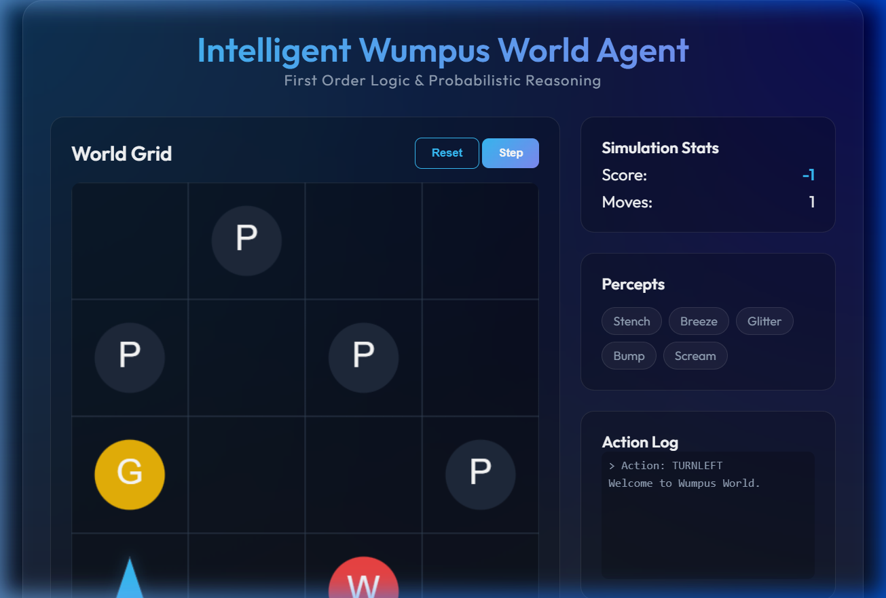
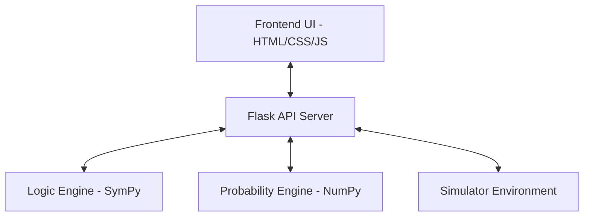

# 🏹 Intelligent Wumpus World Agent Simulator

[](https://www.python.org/downloads/)
[](https://flask.palletsprojects.com/)
[](https://opensource.org/licenses/MIT)

An interactive AI simulation of the classic **Wumpus World problem**, demonstrating how an intelligent agent uses **First Order Logic** and **Probabilistic Reasoning** to navigate an unknown environment and locate hidden treasure while avoiding deadly hazards.

---

## 📸 Simulation Preview


*Live view of the Intelligent Agent navigating the 4x4 grid.*

---

## 🌟 Project Overview

The **Wumpus World** is a well-known problem in Artificial Intelligence used to demonstrate reasoning under uncertainty.

In this simulation:
- An **agent explores a grid-based world**
- The world contains **pits**, a **Wumpus monster**, and **gold**
- The agent **cannot see the entire world**
- It must **infer hidden dangers using percepts and logical reasoning**

### The Percept System

| Percept | Meaning | Icon |
| :--- | :--- | :--- |
| **Breeze** | A pit is nearby | 🌬️ |
| **Stench** | The Wumpus is nearby | 🤢 |
| **Glitter** | Gold is in the current cell | ✨ |
| **Bump** | The agent hit a wall | 🧱 |
| **Scream** | The Wumpus has been killed | 😱 |

---

## 🚀 Key Features

### 🧠 Intelligent AI Agent
- **First Order Logic (FOL):** Uses SymPy-powered deduction to prove tile safety.
- **Probabilistic Reasoning:** When facts are insufficient, the agent calculates risk weights.
- **Dynamic Exploration:** Prioritizes safe tiles and chooses the least risky path when necessary.

### 💻 Interactive Web Simulation
- **Visual 4×4 Grid:** Real-time updates of agent position and world state.
- **Real-Time Percepts:** Current cell signals (Stench, Breeze, etc.) clearly highlighted.
- **Live Action Log:** Transparent view of every decision made by the AI.

### 🎮 Dual Mode Operation
- **Manual Mode:** You control the agent while observing its logical recommendations.
- **Auto Mode:** Let the AI autonomously solve the environment from start to finish.

---

## 🏗️ System Architecture



### Backend Modules
- **Logic Engine:** Implements the Knowledge Base. Infers safe tiles using propositional and first-order logic.
- **Probability Engine:** Calculates risk probabilities for unknown tiles when logic provides no safe options.
- **Simulator:** Manages the game world, truth state, and agent physical interactions.

---

## 📂 Project Structure

```text
wumpus-world-simulator
├── backend/
│   ├── ai/
│   │   ├── agent.py               # Main Intelligent Agent logic
│   │   ├── logic_engine.py        # FOL and Knowledge Base
│   │   └── probability_engine.py  # Probabilistic calculations
│   ├── simulator/
│   │   └── simulator.py           # Core game environment
│   ├── app.py                     # Flask Server Entry Point
│   └── requirements.txt           # Python Dependencies
├── frontend/
│   ├── assets/                    # Images and Icons
│   ├── css/
│   │   └── styles.css             # Glassmorphic UI Styling
│   ├── js/
│   │   ├── api.js                 # API Communication
│   │   ├── main.js                # UI Logic & Controller
│   │   └── renderer.js            # Grid & Stats Rendering
│   └── index.html                 # Main Dashboard
└── README.md
```

---

## 🔨 Technologies Used

- **Python:** The brain of the simulation.
- **Flask:** Light-weight backend API.
- **JavaScript:** Reactive frontend interactions.
- **SymPy:** Powerhouse for logical inference and propositional logic.
- **NumPy:** Handles probabilistic matrices and calculations.

---

## ⚙️ How to Run the Project

### 1️⃣ Clone the Repository
```bash
git clone https://github.com/krishna-marathe/intelligent_wumpus_agent_simulator.git
cd intelligent_wumpus_agent_simulator
```

### 2️⃣ Install Dependencies
```bash
pip install -r backend/requirements.txt
```

### 3️⃣ Start the Backend Server
```bash
python backend/app.py
```

### 4️⃣ Launch the Dashboard
Open your browser and navigate to:
`http://localhost:5000`

---

## 📜 Development Log

### Phase 1: Core Engine
- ✅ Implemented basic 4x4 grid simulator.
- ✅ Added random world generation (Pits, Wumpus, Gold).
- ✅ Built the physical action system (Move, Turn, Grab, Shoot).

### Phase 2: AI Intelligence
- ✅ Integrated **SymPy** for logical deduction.
- ✅ Developed the **Knowledge Base** (KB) to store spatial facts.
- ✅ Implemented **Probabilistic Risk Assessment** for "blind" moves.

### Phase 3: Modern UI
- ✅ Created a premium **Glassmorphism-styled** dashboard.
- ✅ Integrated real-time API polling for state updates.
- ✅ Added the **Action Log** for better transparency.

---

## 🎓 Educational Value

This project is a practical implementation of concepts from **"Artificial Intelligence: A Modern Approach"** by Russell & Norvig. It serves as a study in:
- Knowledge Representation
- Logical Inference (Modus Ponens, Resolution)
- Decision Making under Uncertainty
- Probabilistic Graphical Models

---

## 👤 Author

**Krishna Marathe**
*Student – Vishwakarma Institute of Technology, Pune*

---

## 📄 License

This project is licensed under the MIT License - see the [LICENSE](LICENSE) file for details.
